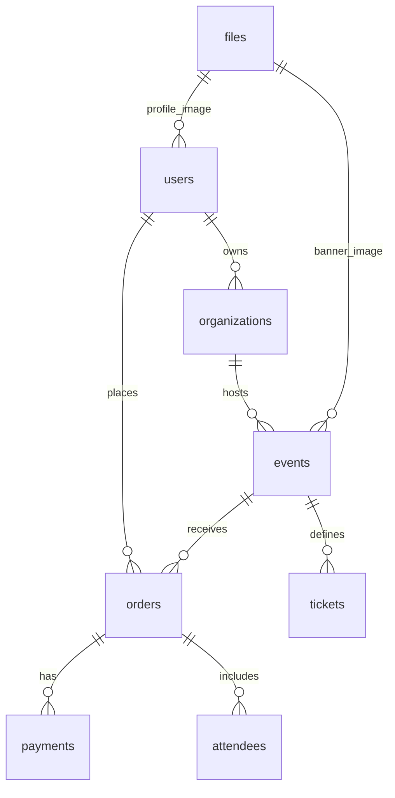
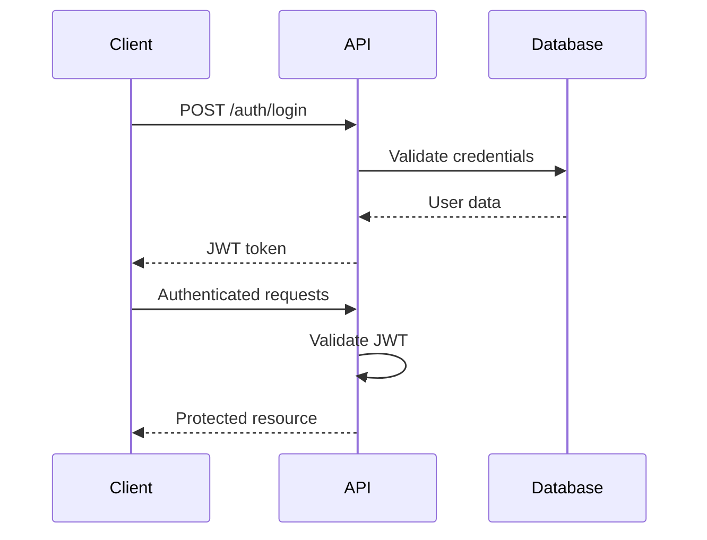

# EventTicketing Platform - Architecture Documentation
**Date:** August 20, 2025  
**Version:** 1.0  
**Status:** Production-Ready Core Implementation

## Table of Contents
1. [System Overview](#system-overview)
2. [Technology Stack](#technology-stack)
3. [Architecture Patterns](#architecture-patterns)
4. [Backend Architecture](#backend-architecture)
5. [Frontend Architecture](#frontend-architecture)
6. [Database Design](#database-design)
7. [API Design](#api-design)
8. [Security Architecture](#security-architecture)
9. [File Storage Architecture](#file-storage-architecture)
10. [Email System Architecture](#email-system-architecture)
11. [Testing Architecture](#testing-architecture)
12. [Deployment Architecture](#deployment-architecture)
13. [Monitoring & Analytics](#monitoring--analytics)
14. [Development Workflow](#development-workflow)
15. [Future Scalability](#future-scalability)

## System Overview

EventTicketing is a modern, scalable event management and ticketing platform built with microservices principles, designed to handle high-volume ticket sales and event management operations.

### Key Capabilities
- **Multi-tenant Event Management**: Organizations can create and manage multiple events
- **Secure Payment Processing**: Stripe integration with PCI compliance
- **Real-time Inventory Management**: Dynamic ticket availability tracking
- **Advanced Media Management**: Image processing, optimization, and CDN-ready storage
- **Comprehensive Analytics**: Revenue tracking, user behavior, and event performance
- **Automated Communications**: Email notifications with professional templates
- **Role-based Access Control**: Admin, organizer, and attendee permissions
- **Mobile-responsive Design**: Progressive Web App capabilities

## Technology Stack

### Backend Stack
```
┌─────────────────────────────────────────┐
│                FastAPI                  │
├─────────────────────────────────────────┤
│            SQLAlchemy 2.0+              │
├─────────────────────────────────────────┤
│              PostgreSQL                 │
├─────────────────────────────────────────┤
│                 Redis                   │
├─────────────────────────────────────────┤
│               Docker                    │
└─────────────────────────────────────────┘
```

**Core Technologies:**
- **FastAPI 0.103+**: High-performance async web framework
- **SQLAlchemy 2.0+**: Modern ORM with async support
- **PostgreSQL 14+**: Primary database with JSON support
- **Redis 7+**: Caching and session management
- **Pydantic 2.0+**: Data validation and serialization
- **Alembic**: Database migrations
- **Poetry**: Dependency management

**Supporting Services:**
- **FastMail**: Email service with template support
- **Stripe**: Payment processing
- **APScheduler**: Background task processing
- **Pillow**: Image processing
- **QRCode**: Ticket generation
- **pytest**: Testing framework

### Frontend Stack
```
┌─────────────────────────────────────────┐
│              Next.js 13+                │
├─────────────────────────────────────────┤
│             TypeScript                  │
├─────────────────────────────────────────┤
│            Tailwind CSS                 │
├─────────────────────────────────────────┤
│           Redux Toolkit                 │
├─────────────────────────────────────────┤
│             React 18+                   │
└─────────────────────────────────────────┘
```

**Core Technologies:**
- **Next.js 13+**: React framework with App Router
- **TypeScript 5.2+**: Type-safe development
- **Tailwind CSS 3.3+**: Utility-first CSS framework
- **Redux Toolkit**: State management
- **React Hook Form**: Form handling with validation
- **Zod**: Schema validation
- **Axios**: HTTP client

**UI Components:**
- **Radix UI**: Accessible component primitives
- **Lucide React**: Icon library
- **React Testing Library**: Component testing
- **Jest**: JavaScript testing framework

## Architecture Patterns

### 1. **Layered Architecture**
```
┌─────────────────────────────────────────┐
│            API Layer                    │  ← FastAPI routes
├─────────────────────────────────────────┤
│          Service Layer                  │  ← Business logic
├─────────────────────────────────────────┤
│           Data Layer                    │  ← SQLAlchemy models
├─────────────────────────────────────────┤
│         Database Layer                  │  ← PostgreSQL
└─────────────────────────────────────────┘
```

### 2. **Domain-Driven Design**
- **Users**: Authentication, profiles, roles
- **Organizations**: Multi-tenant management
- **Events**: Event lifecycle management
- **Tickets**: Inventory and pricing
- **Orders**: Transaction processing
- **Payments**: Financial operations
- **Attendees**: Check-in and management
- **Files**: Media and document management

### 3. **Dependency Injection**
- Database sessions injected via FastAPI dependencies
- Authentication context propagated through request lifecycle
- Service layer abstraction for business logic

## Backend Architecture

### Directory Structure
```
backend/
├── app/
│   ├── api/
│   │   ├── deps.py              # Dependency injection
│   │   └── v1/
│   │       ├── api.py           # Router aggregation
│   │       └── endpoints/        # API endpoints by domain
│   ├── core/
│   │   ├── config.py            # Configuration management
│   │   └── security.py          # Auth & security utilities
│   ├── db/
│   │   ├── base.py              # Model imports
│   │   ├── base_class.py        # Base model class
│   │   └── session.py           # Database sessions
│   ├── models/                  # SQLAlchemy models
│   ├── schemas/                 # Pydantic schemas
│   ├── services/                # Business logic layer
│   ├── tasks/                   # Background tasks
│   ├── templates/               # Email templates
│   └── main.py                  # Application entry point
├── migrations/                  # Alembic migrations
├── tests/                       # Test suite
└── pyproject.toml              # Dependencies
```

### Key Components

#### **1. API Layer (`app/api/`)**
- **RESTful Design**: Following OpenAPI 3.0 standards
- **Version Management**: `/api/v1/` prefix for API versioning
- **Dependency Injection**: Database sessions, authentication
- **Error Handling**: Consistent HTTP error responses
- **Input Validation**: Pydantic schema validation

#### **2. Service Layer (`app/services/`)**
- **Business Logic Isolation**: Separated from HTTP concerns
- **Transaction Management**: Database transaction handling
- **Domain Services**: User, Event, Order, Payment services
- **File Storage Service**: Media management and processing
- **Email Service**: Template rendering and sending

#### **3. Data Models (`app/models/`)**
- **SQLAlchemy 2.0 Style**: Modern async ORM patterns
- **Relationship Management**: Proper foreign keys and indexes
- **Audit Fields**: Created/updated timestamps
- **Soft Deletes**: Where appropriate for data retention

#### **4. Background Tasks (`app/tasks/`)**
- **Email Processing**: Automated notifications and reminders
- **Scheduled Jobs**: Event reminders, daily digests
- **APScheduler Integration**: Cron-like task scheduling

### Database Schema Overview


## Frontend Architecture

### Directory Structure
```
frontend/src/
├── app/                         # Next.js App Router
│   ├── auth/                    # Authentication pages
│   ├── dashboard/               # User dashboard
│   ├── events/                  # Event pages
│   ├── layout.tsx               # Root layout
│   └── page.tsx                 # Home page
├── components/                  # React components
│   ├── payment/                 # Payment components
│   ├── tickets/                 # Ticket management
│   ├── upload/                  # File upload
│   └── ui/                      # Base UI components
├── context/                     # React contexts
├── hooks/                       # Custom React hooks
├── lib/
│   ├── api/                     # API client services
│   └── utils.ts                 # Utility functions
├── store/                       # Redux store
└── types/                       # TypeScript definitions
```

### Key Components

#### **1. State Management**
- **Redux Toolkit**: Global state management
- **RTK Query**: Data fetching and caching
- **React Context**: Authentication state
- **Local State**: Component-specific state

#### **2. API Integration**
- **Axios Client**: HTTP requests with interceptors
- **Authentication**: JWT token management
- **Error Handling**: Centralized error processing
- **Request/Response**: Type-safe API calls

#### **3. Component Architecture**
- **Atomic Design**: Reusable component hierarchy
- **Compound Components**: Complex UI patterns
- **Render Props**: Flexible component composition
- **Custom Hooks**: Logic extraction and reuse

#### **4. Form Management**
- **React Hook Form**: Performance-optimized forms
- **Zod Validation**: Schema-based validation
- **Error Handling**: User-friendly error messages
- **File Uploads**: Drag-and-drop interfaces

## Database Design

### Core Entities

#### **Users Table**
```sql
CREATE TABLE users (
    id SERIAL PRIMARY KEY,
    email VARCHAR UNIQUE NOT NULL,
    full_name VARCHAR,
    hashed_password VARCHAR NOT NULL,
    is_active BOOLEAN DEFAULT true,
    is_superuser BOOLEAN DEFAULT false,
    profile_image_path VARCHAR(500),
    created_at TIMESTAMP WITH TIME ZONE DEFAULT NOW(),
    updated_at TIMESTAMP WITH TIME ZONE DEFAULT NOW()
);
```

#### **Events Table**
```sql
CREATE TABLE events (
    id SERIAL PRIMARY KEY,
    title VARCHAR NOT NULL,
    description TEXT,
    location VARCHAR,
    start_date TIMESTAMP WITH TIME ZONE,
    end_date TIMESTAMP WITH TIME ZONE,
    is_active BOOLEAN DEFAULT true,
    max_attendees INTEGER,
    banner_image_path VARCHAR(500),
    gallery_images TEXT, -- JSON array
    organization_id INTEGER REFERENCES organizations(id),
    category_id INTEGER REFERENCES event_categories(id),
    created_at TIMESTAMP WITH TIME ZONE DEFAULT NOW(),
    updated_at TIMESTAMP WITH TIME ZONE DEFAULT NOW()
);
```

#### **Orders Table**
```sql
CREATE TABLE orders (
    id SERIAL PRIMARY KEY,
    order_number VARCHAR UNIQUE NOT NULL,
    user_id INTEGER REFERENCES users(id),
    event_id INTEGER REFERENCES events(id),
    status VARCHAR NOT NULL DEFAULT 'pending',
    total_amount DECIMAL(10,2) NOT NULL,
    created_at TIMESTAMP WITH TIME ZONE DEFAULT NOW(),
    updated_at TIMESTAMP WITH TIME ZONE DEFAULT NOW()
);
```

### Indexing Strategy
- **Primary Keys**: B-tree indexes on all primary keys
- **Foreign Keys**: Indexes on all foreign key columns
- **Search Fields**: Composite indexes on commonly searched fields
- **Date Ranges**: Indexes on timestamp fields for reporting
- **Email Lookups**: Unique index on user emails

### Data Integrity
- **Foreign Key Constraints**: Referential integrity enforcement
- **Check Constraints**: Business rule validation
- **Unique Constraints**: Data uniqueness enforcement
- **Not Null Constraints**: Required field validation

## API Design

### RESTful Principles
- **Resource-based URLs**: `/api/v1/events/{id}`
- **HTTP Methods**: GET, POST, PUT, DELETE semantic usage
- **Status Codes**: Proper HTTP response codes
- **Content Negotiation**: JSON request/response format
- **Idempotency**: Safe retry operations

### Authentication & Authorization
```
┌─────────────────────────────────────────┐
│            JWT Token                    │
├─────────────────────────────────────────┤
│          OAuth2 Bearer                  │
├─────────────────────────────────────────┤
│         Role-based Access               │
├─────────────────────────────────────────┤
│       Permission Decorators             │
└─────────────────────────────────────────┘
```

### API Endpoints Structure
```
/api/v1/
├── auth/           # Authentication endpoints
├── users/          # User management
├── events/         # Event management
├── tickets/        # Ticket operations
├── orders/         # Order processing
├── payments/       # Payment handling
├── files/          # File management
├── email/          # Email operations
└── admin/          # Admin dashboard
```

### Error Handling
```json
{
  "detail": "Validation error",
  "errors": [
    {
      "field": "email",
      "message": "Invalid email format"
    }
  ],
  "timestamp": "2025-08-20T18:00:00Z",
  "path": "/api/v1/users"
}
```

## Security Architecture

### Authentication Flow


### Security Measures Implemented
- **JWT Authentication**: Stateless token-based auth
- **Password Hashing**: bcrypt with salt
- **CORS Protection**: Configurable origin restrictions
- **Input Validation**: Pydantic schema validation
- **SQL Injection Prevention**: ORM parameterized queries
- **File Upload Security**: Type and size validation

### Security Measures Planned
- **Rate Limiting**: Request throttling per IP/user
- **CSRF Protection**: Cross-site request forgery prevention
- **Security Headers**: HSTS, CSP, X-Frame-Options
- **API Key Management**: Service-to-service authentication
- **Audit Logging**: Security event tracking

## File Storage Architecture

### Storage Strategy
```
┌─────────────────────────────────────────┐
│           Local Storage                 │  ← Development
├─────────────────────────────────────────┤
│            Cloud Storage                │  ← Production (S3/GCS)
├─────────────────────────────────────────┤
│              CDN Layer                  │  ← Global distribution
└─────────────────────────────────────────┘
```

### File Processing Pipeline
1. **Upload Validation**: Type, size, security checks
2. **Image Processing**: Resize, optimize, create variants
3. **Storage**: Save to configured storage backend
4. **Metadata**: Store file info in database
5. **URL Generation**: Create public access URLs

### Supported Formats
- **Images**: JPEG, PNG, WebP, GIF
- **Documents**: PDF, CSV, Excel, Text
- **Size Limits**: 10MB images, 50MB documents
- **Image Variants**: Thumbnail, medium, large, banner

### Security Features
- **Path Traversal Protection**: Secure file naming
- **Virus Scanning**: Ready for integration
- **Access Control**: Permission-based file access
- **Watermarking**: Brand protection for images

## Email System Architecture

### Email Service Components
```
┌─────────────────────────────────────────┐
│          FastMail Service               │
├─────────────────────────────────────────┤
│         Jinja2 Templates                │
├─────────────────────────────────────────┤
│        Background Tasks                 │
├─────────────────────────────────────────┤
│         SMTP Configuration              │
└─────────────────────────────────────────┘
```

### Email Templates
- **Welcome Email**: User onboarding
- **Password Reset**: Secure password recovery
- **Order Confirmation**: Purchase verification
- **Ticket Delivery**: Digital ticket distribution
- **Event Reminders**: Automated notifications
- **Payment Receipts**: Transaction confirmations

### Delivery Features
- **Background Processing**: Non-blocking email sending
- **Template Engine**: Dynamic content generation
- **Responsive Design**: Mobile-friendly emails
- **Retry Logic**: Failed delivery handling
- **Tracking**: Delivery status monitoring

## Testing Architecture

### Backend Testing
```
backend/tests/
├── conftest.py              # Test configuration
├── test_main.py             # Application tests
├── api/
│   └── test_auth.py         # API endpoint tests
└── services/
    └── test_user.py         # Service layer tests
```

**Testing Features:**
- **Async Support**: pytest-asyncio integration
- **Database Testing**: Transaction isolation
- **Fixture Management**: Reusable test data
- **Coverage Reporting**: Code coverage metrics
- **Integration Tests**: End-to-end API testing

### Frontend Testing
```
frontend/__tests__/
├── setup.test.ts            # Test configuration
├── simple.test.ts           # Basic functionality
├── components/              # Component tests
├── hooks/                   # Hook tests
└── lib/                     # Utility tests
```

**Testing Features:**
- **Component Testing**: React Testing Library
- **Unit Testing**: Jest test runner
- **Mock Management**: API and service mocking
- **Coverage Tracking**: Code coverage reporting
- **TypeScript Support**: Type-safe testing

## Deployment Architecture

### Container Strategy
```
┌─────────────────────────────────────────┐
│              Frontend                   │  ← Next.js container
├─────────────────────────────────────────┤
│              Backend                    │  ← FastAPI container
├─────────────────────────────────────────┤
│             PostgreSQL                  │  ← Database container
├─────────────────────────────────────────┤
│               Redis                     │  ← Cache container
└─────────────────────────────────────────┘
```

### Docker Compose Configuration
- **Development Environment**: Local development setup
- **Hot Reloading**: Code change detection
- **Volume Mapping**: Source code synchronization
- **Environment Variables**: Configuration management
- **Service Dependencies**: Proper startup ordering

### Production Considerations
- **Load Balancing**: Multiple API instances
- **Database Clustering**: High availability
- **Redis Clustering**: Cache distribution
- **File Storage**: Cloud storage integration
- **Monitoring**: Health checks and metrics

## Monitoring & Analytics

### Admin Dashboard Features
- **Real-time Statistics**: User, event, order counts
- **Revenue Analytics**: Daily, monthly, yearly reports
- **User Management**: Admin user operations
- **Event Oversight**: Event approval and moderation
- **System Health**: Service status monitoring

### Metrics Collection
- **Business Metrics**: Revenue, conversions, user growth
- **Technical Metrics**: Response times, error rates
- **User Behavior**: Page views, engagement
- **Performance Metrics**: Database queries, cache hits

### Planned Monitoring
- **Application Performance Monitoring (APM)**
- **Error Tracking**: Sentry integration
- **Log Aggregation**: Centralized logging
- **Alerting**: Issue notification system

## Development Workflow

### Code Quality
- **Linting**: ESLint (frontend), Ruff (backend)
- **Formatting**: Prettier (frontend), Black (backend)
- **Type Checking**: TypeScript, mypy
- **Pre-commit Hooks**: Automated quality checks

### Git Workflow
- **Feature Branches**: Isolated development
- **Pull Request Reviews**: Code review process
- **Automated Testing**: CI/CD integration
- **Semantic Versioning**: Release management

### Development Tools
- **Poetry**: Python dependency management
- **npm**: JavaScript package management
- **Docker**: Containerized development
- **VS Code**: Recommended IDE setup

## Future Scalability

### Horizontal Scaling
- **API Instances**: Load-balanced FastAPI containers
- **Database Sharding**: Data distribution strategies
- **Cache Distribution**: Redis cluster setup
- **CDN Integration**: Global content delivery

### Microservices Evolution
```
Current Monolith → Future Microservices
├── User Service
├── Event Service
├── Payment Service
├── Notification Service
├── File Service
└── Analytics Service
```

### Technology Upgrades
- **Database**: PostgreSQL clustering, read replicas
- **Search**: Elasticsearch integration
- **Message Queue**: Redis Pub/Sub or RabbitMQ
- **API Gateway**: Kong or Ambassador
- **Service Mesh**: Istio for microservices

### Performance Optimizations
- **Database Indexing**: Query optimization
- **Caching Strategy**: Multi-layer caching
- **API Optimization**: Response compression, pagination
- **Frontend**: Code splitting, lazy loading
- **CDN**: Static asset optimization

---

## Implementation Status

### ✅ **Completed (Production Ready)**
- Testing Infrastructure (Backend + Frontend)
- Email Notification System with Templates
- File Upload & Media Management
- Admin Dashboard with Analytics
- Core API Endpoints
- Database Models and Migrations
- Authentication & Authorization
- Docker Development Environment

### 🚧 **In Progress**
- Security Enhancements (Rate Limiting, CSRF)
- Advanced Search & Filtering
- Real-time Features (WebSocket)
- Performance Optimizations

### 📋 **Planned**
- CI/CD Pipeline
- Mobile PWA Features
- Advanced Event Features
- Monitoring & Logging
- Documentation Enhancement

---

**Document Maintained By:** Development Team  
**Last Updated:** August 20, 2025  
**Next Review:** September 1, 2025